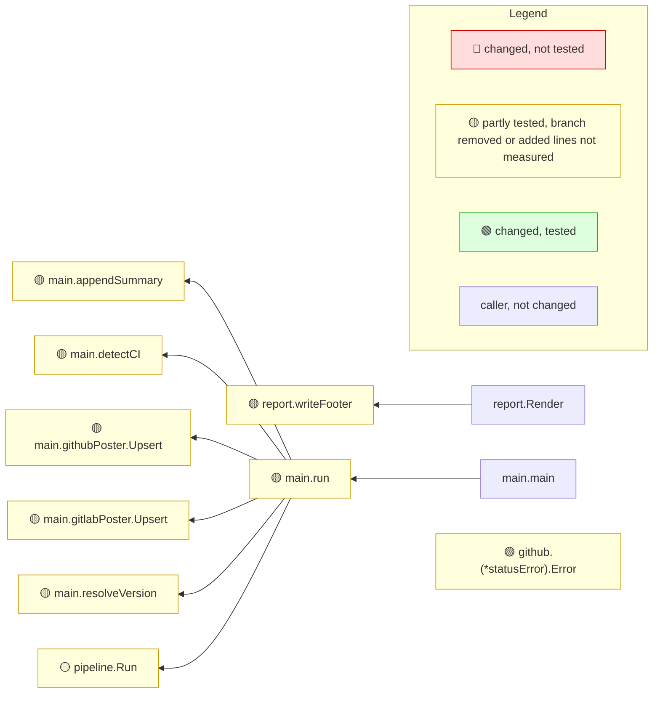

# mrimpact

**One comment on every Go pull request: what changed, who calls it, which entry points reach it, and whether a test covers it.**

[](https://github.com/Kevinbarrero/mr-impact/actions/workflows/ci.yml)
[](https://github.com/Kevinbarrero/mr-impact/releases/latest)
[](https://pkg.go.dev/github.com/Kevinbarrero/mr-impact)
[](https://goreportcard.com/report/github.com/Kevinbarrero/mr-impact)
[](LICENSE)

`mrimpact` reads a Go pull request (GitHub) or merge request (GitLab), builds the call graph of both revisions and posts one risk-ranked note, updated in place on every run. Zero config, offline, deterministic, no AI.

## A real note

This is the note mrimpact v0.4.0 writes for its own GitHub support (`mrimpact --base fb160f5 --no-post` on that change, no coverprofile, so test reach is static and functions with added lines are at most 🟡 until a coverprofile measures them), unedited:

<details>
<summary>mrimpact on its own change: 15 functions changed, 🔴 0 · 🟡 9 · 🟢 0</summary>

<!-- mrimpact:v1 -->
### 🔍 MR impact — 15 functions changed
**🔴 0 · 🟡 9 · 🟢 0** · coverage: `static` · base `fb160f5`\
+6 new functions folded into 1 group

👉 **Look at first:** `main.run` (branch removed) · `main.appendSummary` (added lines not measured) · `main.detectCI` (added lines not measured) +6

🔐 **Sensitive code changed** (2):

- 🟡 `github.(*Client).once` — net/http.(*Client).Do · reached by test · added lines not measured
- 🟡 `main.appendSummary` — os.OpenFile · reached by test · added lines not measured

All changes shown are reached from: main

| Risk | Function | Change | Callers | Entry points | Added-line coverage |
|---|---|---|---|---|---|
| 🟡 | `main.appendSummary` | new · sensitive | 2 | — | reached by test · added lines not measured |
| 🟡 | `main.detectCI` | new | 2 | — | reached by test · added lines not measured |
| 🟡 | `main.githubPoster.Upsert` | new · +6 | 2 | — | reached by test · added lines not measured |
| 🟡 | `main.gitlabPoster.Upsert` | new | 2 | — | reached by test · added lines not measured |
| 🟡 | `main.resolveVersion` | new | 2 | — | reached by test · added lines not measured |
| 🟡 | `pipeline.Run` | body | 2 | — | reached by test · added lines not measured |
| 🟡 | `report.writeFooter` | body · wiring | 2 (2 pkgs) | — | reached by test · added lines not measured |
| 🟡 | `main.run` | body (branch removed · 1 of 8 moved to `main.detectCI`) | 1 | — | reached by test · added lines not measured |
| 🟡 | `github.(*statusError).Error` | new · wiring | 0 | — | reached by test · added lines not measured |

<details><summary>main.githubPoster.Upsert +6 new</summary>

- 🟡 `github.(*Client).Upsert` · new · reached by test · added lines not measured — `internal/github/github.go`
- 🟡 `github.(*Client).do` · new · reached by test · added lines not measured — `internal/github/github.go`
- 🟡 `github.(*Client).followable` · new · reached by test · added lines not measured — `internal/github/github.go`
- 🟡 `github.(*Client).once` · new · sensitive · reached by test · added lines not measured — `internal/github/github.go`
- 🟡 `github.nextLink` · new · reached by test · added lines not measured — `internal/github/github.go`
- 🟡 `github.snippet` · new · reached by test · added lines not measured — `internal/github/github.go`

</details>

📝 Declarations changed: 18 in 5 files

<details><summary>Declarations (18)</summary>

- `cmd/mrimpact/ci.go` (6): `type poster`, `type githubUpserter`, `var newGitHubClient`, `type ciEnv`, `type gitlabPoster`, `type githubPoster`
- `cmd/mrimpact/main.go` (1): `var version`
- `internal/diff/git.go` (1): `var ErrShallow`
- `internal/github/github.go` (8): `const defaultBaseURL`, `const defaultAuthor`, `const maxPages`, `var retryDelays`, `type Client`, `type comment`, `type statusError`, `var nextRe`
- `internal/pipeline/pipeline.go` (2): `const Version`, `type Config`

</details>

🧪 Tests touched in this MR: 18 files

<details><summary>Test files (18)</summary>

- `cmd/mrimpact` (2): `ci_test.go`, `main_test.go`
- `internal/arch` (2): `fromconfig_test.go`, `graph_test.go`
- `internal/callgraph` (1): `callgraph_test.go`
- `internal/configfields` (1): `configfields_test.go`
- `internal/coverage` (1): `coverage_test.go`
- `internal/diff` (2): `export_test.go`, `git_test.go`
- `internal/github` (1): `github_test.go`
- `internal/pipeline` (3): `e2e_test.go`, `entry_test.go`, `group_test.go`
- `internal/registrations` (1): `registrations_test.go`
- `internal/report` (1): `report_test.go`
- `internal/risk` (1): `risk_test.go`
- `internal/sensitive` (1): `sensitive_test.go`
- `internal/symbols` (1): `symbols_test.go`

</details>

**How to read the diagram:** coloured boxes are functions this MR changed (🔴 not tested · 🟡 partly tested, branch removed or added lines not measured · 🟢 tested); plain boxes are callers the MR did not change; an arrow points from a caller to the function it calls; a dashed arrow means the function is passed as a callback (registered) and called through it. Every caller is listed under *All callers*.



<details><summary>All callers (15)</summary>

**`main.appendSummary`** (2)

- depth 1: `main.run`
- depth 2: `main.main`

**`main.detectCI`** (2)

- depth 1: `main.run`
- depth 2: `main.main`

**`main.githubPoster.Upsert`** (2)

- depth 1: `main.run`
- depth 2: `main.main`

**`main.gitlabPoster.Upsert`** (2)

- depth 1: `main.run`
- depth 2: `main.main`

**`main.resolveVersion`** (2)

- depth 1: `main.run`
- depth 2: `main.main`

**`pipeline.Run`** (2)

- depth 1: `main.run`
- depth 2: `main.main`

**`report.writeFooter`** (2)

- depth 1: `report.Render`
- depth 2: `main.run`

**`main.run`** (1)

- depth 1: `main.main`

</details>

<details><summary>⚠️ Limits of this analysis</summary>

- Calls via `reflect` or dynamic registration (e.g. handlers by name) are not detected.
- This repo only: callers in other services (HTTP/gRPC) are not visible.
- Functions called only from dependencies (e.g. HTTP handlers registered with net/http) or from package-level initializers show no callers (methods the standard library calls on interface values, such as `Error`, `Unwrap` or `ServeHTTP`, count as reached from the code that converts their type to an interface; see the list in the reference); where such a function is registered is listed under Registered.
- Now unused: uses through `reflect`, `//go:linkname` or other repositories are not seen; exported methods, and exported functions of packages other modules can import, are never listed.
</details>

<sub>Rules: 🔴 untested with callers, or exported signature changed in an importable package · 🟡 partial, untested with no callers, a branch removed, or added lines not measured · 🟢 covered, or no added lines and reached by a test · wiring (straight-line setup) at most 🟡 · sensitive and untested 🔴 · mrimpact v0.4.0 · 1.8 s</sub>

</details>

## What a reviewer learns

- **What changed, ranked by risk:** every changed function with its kind (`new`, `body`, `signature`, a removed branch, straight-line wiring), rated 🔴/🟡/🟢 by fixed rules; the riskiest rows are named in a `Look at first` line, a branch that moved to another function says where, and a big MR collapses its lesser rows.
- **Who depends on it:** its callers up to `--depth`, where it is registered as a callback, and the entry points that reach it: routes and handlers, exported API, `main` and `init`.
- **Whether a test covers it:** the coverage of the added lines from your coverprofile, or, without one, whether any test reaches the function in the call graph, across packages, including methods the standard library calls (`Unwrap` through `errors.Is`, `ServeHTTP`); without a coverprofile a function with added lines is at most 🟡 (`added lines not measured`). A `go.work` in effect is stated in a `📦` line.
- **Untested sensitive code:** changed functions that call process, file, SQL, HTTP, crypto, deserialization or mutating reflection APIs (or sit in a package you mark `critical`) and have no test.
- **What the change left behind:** code now unused, config fields nothing reads any more, registrations removed or rewired, and new import edges that break the architecture's layer rules.

## Quickstart

**GitHub Actions** (`.github/workflows/mrimpact.yml`):

```yaml
name: mrimpact
on: pull_request

jobs:
  mrimpact:
    runs-on: ubuntu-latest
    permissions:
      contents: read
      pull-requests: write
    steps:
      - uses: actions/checkout@v4
        with:
          fetch-depth: 0
      - uses: actions/setup-go@v5
        with:
          go-version-file: go.mod
      - uses: Kevinbarrero/mr-impact@v0
        with:
          run-tests: true   # optional: go test ./... -coverprofile first
```

Use `pull_request`, never `pull_request_target`: the latter runs the pull request's code with a write token ([why](docs/reference.md#do-not-use-pull_request_target)). On fork pull requests the note goes to the job summary.

**GitLab CI** (`.gitlab-ci.yml`), then add a Project Access Token as the masked variable `MRIMPACT_TOKEN` ([token setup](docs/reference.md#token-setup)):

```yaml
include:
  - remote: https://raw.githubusercontent.com/Kevinbarrero/mr-impact/main/ci/mrimpact.gitlab-ci.yml
```

**Locally:**

```sh
go install github.com/Kevinbarrero/mr-impact/cmd/mrimpact@latest
# or a verified release binary:
curl -sSfL https://raw.githubusercontent.com/Kevinbarrero/mr-impact/main/install.sh | sh -s -- -b ~/.local/bin

mrimpact --base origin/main     # run from the module root; prints the note, posts nothing
```

Flags, configuration, the action inputs, the GitLab variables and every section of the note are in the [reference](docs/reference.md).

## Examples

Notes from merged pull requests of well-known Go projects, unedited, with the commands that produced them ([all examples](docs/examples/README.md)):

- [gin-gonic/gin#4800](docs/examples/gin-4800.md): three `net/http.Server` call sites flagged as sensitive, the `ginS` wrappers reached, and a callers list from which a reviewer can check whether `RunUnix` is covered by the new `ReadHeaderTimeout`.
- [spf13/cobra#1956](docs/examples/cobra-1956.md): the one function left executing `text/template`, reached only from the `Set*Template` API, which is the point of the PR.
- [caddyserver/caddy#8346](docs/examples/caddy-8346.md): a red row with 84 % coverage, because an exported function of an importable package changed its signature.
- [prometheus/prometheus#20028](docs/examples/prometheus-20028.md): new HTTP routes, an exported constructor's new parameters and an inferred architecture hint, in static mode; with one misfire (a registration call given new arguments shown as removed and added). Fixed in v0.3.2: it now shows under "Registrations changed".

## How it works

mrimpact diffs the head against the merge base of `--base` with `git`, exports the base revision with `git archive` into a temporary directory, and type-checks both revisions with `go/packages`. It maps the changed lines to functions, builds an SSA call graph (VTA) to find callers, entry points and the tests that reach each function, reads your coverprofiles if you give any, compares the package import graph against layer rules, and applies fixed rules to rate each function. The result is Markdown with a Mermaid diagram, posted as one comment that is updated in place. The same input always gives the same note; nothing leaves the runner except that comment.

## Compared to

mrimpact is a reviewer's map of a change, not a linter, a coverage service or a security scanner. It sits next to these tools:

| Tool | What it does | What mrimpact adds | When you still want it |
|---|---|---|---|
| Codecov / diff-cover | Coverage of the changed lines from a coverage report, with project history and gates | Which *functions* changed, their callers and entry points; static test reach when there is no coverprofile, and tests in other packages that reach the code | Coverage trends over time, percentage gates, other languages |
| golangci-lint + reviewdog | Lint findings (bugs, style, complexity) posted on the changed lines | The change's reach: callers, entry points, removed registrations, code left unused | Always: mrimpact reports no lint issues |
| `deadcode` | Functions unreachable from `main` in the whole program | Only what *this* change made unused, plus config fields and generated code no longer used, in the review | Whole-program cleanups and audits |
| arch-go / go-arch-lint | Enforce declared architecture rules from a rule file, failing the build | Zero-config inferred layer hints, presets, only the *new* violations of the diff, coupling (Martin metrics) before and after | A dedicated rule file with more rule kinds, enforced on the whole codebase |
| govulncheck | Known vulnerabilities (Go vulnerability database) in the code and dependencies, by reachability | Untested changes to sensitive APIs in your own code; it knows no CVEs | Always, for known vulnerabilities |
| SonarQube | A server-based multi-language platform: quality gates, issues, security hotspots, coverage, duplication | A single offline binary with a Go call graph and entry points, no server and no account | Organisation-wide dashboards and gates across languages |
| AI reviewers | Comments from a language model on the diff's logic, naming and intent | Deterministic, offline facts: the same input gives the same note, no code is sent anywhere | Reading the code's intent and suggesting changes, which mrimpact does not do |

## Limitations

- **Go only**, and **one module per run**: run it from the module root (`--dir`); callers in other modules or services are not seen.
- **Reflection and plugins are not followed:** calls through `reflect`, `plugin`, `//go:linkname` or registration by name are not detected.
- **The Go toolchain is required on the runner**, the version your module needs: the action does not install Go (use `actions/setup-go`), and the GitLab template uses the `golang` image.
- **Full history:** the base commit must be in the clone (`fetch-depth: 0` / `GIT_DEPTH: 0`).
- **Signatures are compared as written:** replacing a type by an alias of it (`type Completion = string`) reads as a signature change, red when exported.
- **Framework registries filled in `init`** (e.g. Caddyfile directives) hide test reach: a function dispatched through one can read *not reached* although tests run it; a coverprofile made with `-coverpkg=./...` shows its real coverage.

The full list is under [Limits](docs/reference.md#limits) in the reference.

## License

[Apache-2.0](LICENSE). Contributions are welcome: see [CONTRIBUTING.md](CONTRIBUTING.md) and, for vulnerabilities, [SECURITY.md](SECURITY.md).
