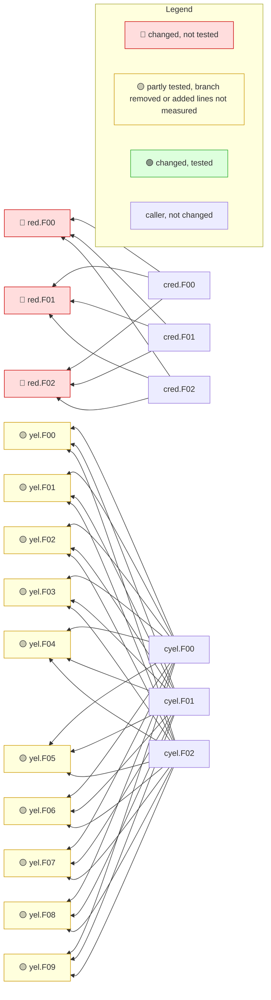

<!-- mrimpact:v1 -->
### 🔍 MR impact — 21 functions changed
**🔴 3 · 🟡 12 · 🟢 6** · coverage: `static` · base `abcdef0`

👉 **Look at first:** `red.F00` (r) · `red.F01` (r) · `red.F02` (r) +12

| Risk | Function | Change | Callers | Added-line coverage |
|---|---|---|---|---|
| 🔴 | `red.F00` | body | 3 | n/a |
| 🔴 | `red.F01` | body | 3 | n/a |
| 🔴 | `red.F02` | body | 3 | n/a |
| 🟡 | `yel.F00` | body | 3 | n/a |
| 🟡 | `yel.F01` | body | 3 | n/a |
| 🟡 | `yel.F02` | body | 3 | n/a |
| 🟡 | `yel.F03` | body | 3 | n/a |
| 🟡 | `yel.F04` | body | 3 | n/a |
| 🟡 | `yel.F05` | body | 3 | n/a |
| 🟡 | `yel.F06` | body | 3 | n/a |
| 🟡 | `yel.F07` | body | 3 | n/a |
| 🟡 | `yel.F08` | body | 3 | n/a |
| 🟡 | `yel.F09` | body | 3 | n/a |

8 more changed functions (🟡 2 · 🟢 6)

| Risk | Function | Change | Callers | Added-line coverage |
|---|---|---|---|---|
| 🟡 | `yel.F10` | body | 3 | n/a |
| 🟡 | `yel.F11` | body | 3 | n/a |
| 🟢 | `grn.F00` | body | 3 | n/a |
| 🟢 | `grn.F01` | body | 3 | n/a |
| 🟢 | `grn.F02` | body | 3 | n/a |
| 🟢 | `grn.F03` | body | 3 | n/a |
| 🟢 | `grn.F04` | body | 3 | n/a |
| 🟢 | `grn.F05` | body | 3 | n/a |

**How to read the diagram:** coloured boxes are functions this MR changed (🔴 not tested · 🟡 partly tested, branch removed or added lines not measured · 🟢 tested); plain boxes are callers the MR did not change; an arrow points from a caller to the function it calls; a dashed arrow means the function is passed as a callback (registered) and called through it. Every caller is listed under *All callers*.

All callers (39)

**`red.F00`** (3)

- depth 1: `cred.F00`, `cred.F01`, `cred.F02`

**`red.F01`** (3)

- depth 1: `cred.F00`, `cred.F01`, `cred.F02`

**`red.F02`** (3)

- depth 1: `cred.F00`, `cred.F01`, `cred.F02`

**`yel.F00`** (3)

- depth 1: `cyel.F00`, `cyel.F01`, `cyel.F02`

**`yel.F01`** (3)

- depth 1: `cyel.F00`, `cyel.F01`, `cyel.F02`

**`yel.F02`** (3)

- depth 1: `cyel.F00`, `cyel.F01`, `cyel.F02`

**`yel.F03`** (3)

- depth 1: `cyel.F00`, `cyel.F01`, `cyel.F02`

**`yel.F04`** (3)

- depth 1: `cyel.F00`, `cyel.F01`, `cyel.F02`

**`yel.F05`** (3)

- depth 1: `cyel.F00`, `cyel.F01`, `cyel.F02`

**`yel.F06`** (3)

- depth 1: `cyel.F00`, `cyel.F01`, `cyel.F02`

**`yel.F07`** (3)

- depth 1: `cyel.F00`, `cyel.F01`, `cyel.F02`

**`yel.F08`** (3)

- depth 1: `cyel.F00`, `cyel.F01`, `cyel.F02`

**`yel.F09`** (3)

- depth 1: `cyel.F00`, `cyel.F01`, `cyel.F02`

⚠️ Limits of this analysis

- Calls via `reflect` or dynamic registration (e.g. handlers by name) are not detected.
- This repo only: callers in other services (HTTP/gRPC) are not visible.
- Functions called only from dependencies (e.g. HTTP handlers registered with net/http) or from package-level initializers show no callers (methods the standard library calls on interface values, such as `Error`, `Unwrap` or `ServeHTTP`, count as reached from the code that converts their type to an interface; see the list in the reference); where such a function is registered is listed under Registered.
- Now unused: uses through `reflect`, `//go:linkname` or other repositories are not seen; exported methods, and exported functions of packages other modules can import, are never listed.

Rules: 🔴 untested with callers, or exported signature changed in an importable package · 🟡 partial, untested with no callers, a branch removed, or added lines not measured · 🟢 covered, or no added lines and reached by a test · wiring (straight-line setup) at most 🟡 · sensitive and untested 🔴 · mrimpact v0.1.0 · 1.0 s
