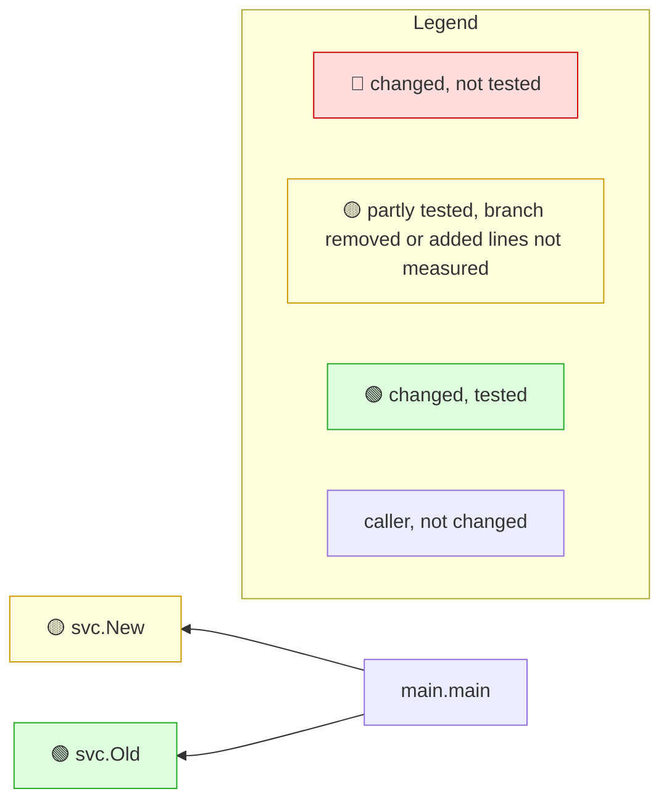

<!-- mrimpact:v1 -->
### 🔍 MR impact — 4 functions changed
**🔴 0 · 🟡 1 · 🟢 1** · coverage: `coverprofile` · base `abcdef0`\
+2 new functions folded into 1 group

👉 **Look at first:** `svc.New`

| Risk | Function | Change | Callers | Added-line coverage |
|---|---|---|---|---|
| 🟡 | `svc.New` | new · +2 | 1 | 67 % (4/6) · 1 untested |
| 🟢 | `svc.Old` | body | 1 | 100 % (1/1) |

svc.New +2 new

- 🟢 `svc.load` · new · 100 % (2/2) — `svc/load.go`
- 🟡 `svc.fmt` · new · 0 % (0/2) — `svc/fmt.go`

**How to read the diagram:** coloured boxes are functions this MR changed (🔴 not tested · 🟡 partly tested, branch removed or added lines not measured · 🟢 tested); plain boxes are callers the MR did not change; an arrow points from a caller to the function it calls; a dashed arrow means the function is passed as a callback (registered) and called through it. Every caller is listed under *All callers*.

All callers (2)

**`svc.New`** (1)

- depth 1: `main.main`

**`svc.Old`** (1)

- depth 1: `main.main`

⚠️ Limits of this analysis

- Calls via `reflect` or dynamic registration (e.g. handlers by name) are not detected.
- This repo only: callers in other services (HTTP/gRPC) are not visible.
- Functions called only from dependencies (e.g. HTTP handlers registered with net/http) or from package-level initializers show no callers (methods the standard library calls on interface values, such as `Error`, `Unwrap` or `ServeHTTP`, count as reached from the code that converts their type to an interface; see the list in the reference); where such a function is registered is listed under Registered.
- Now unused: uses through `reflect`, `//go:linkname` or other repositories are not seen; exported methods, and exported functions of packages other modules can import, are never listed.

Rules: 🔴 untested with callers, or exported signature changed in an importable package · 🟡 partial, untested with no callers, a branch removed, or added lines not measured · 🟢 covered, or no added lines and reached by a test · wiring (straight-line setup) at most 🟡 · sensitive and untested 🔴 · mrimpact v0.1.0 · 1.0 s
