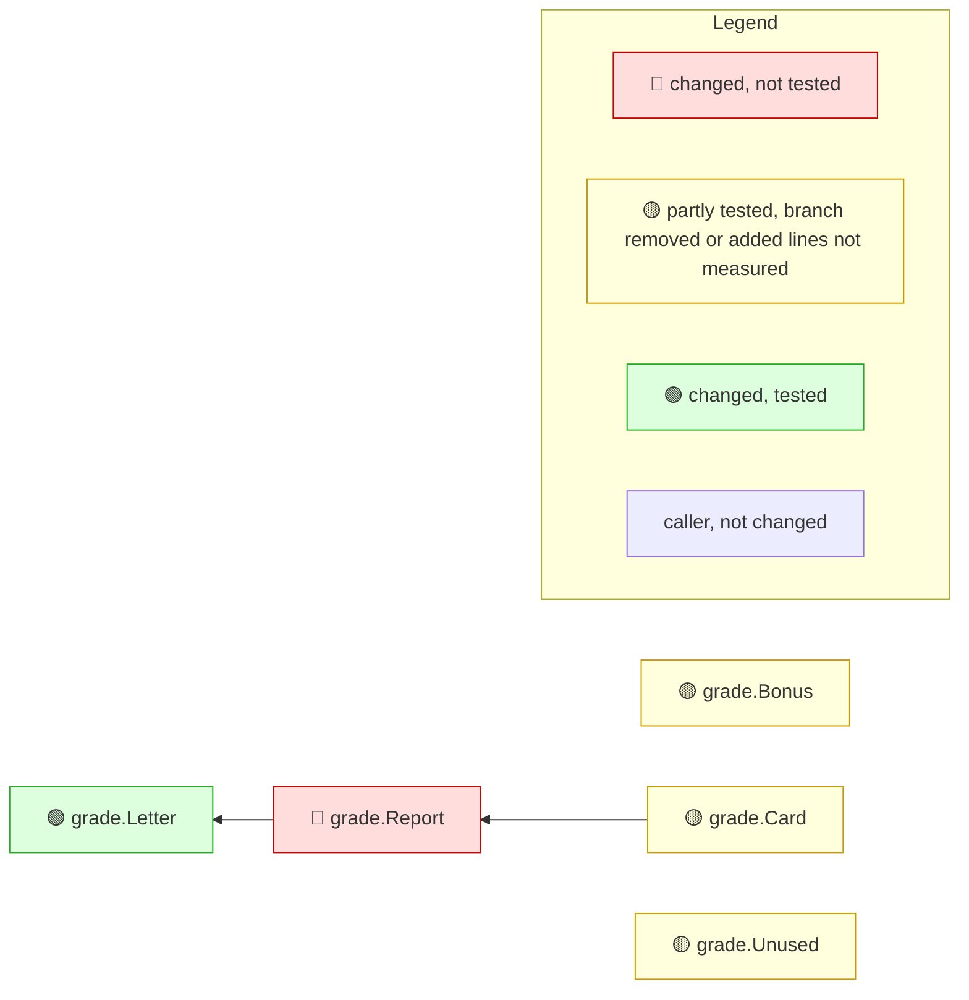

<!-- mrimpact:v1 -->
### 🔍 MR impact — 5 functions changed
**🔴 1 · 🟡 3 · 🟢 1** · coverage: `coverprofile` · base `0000000`

👉 **Look at first:** `grade.Report` (untested, 1 caller) · `grade.Bonus` (partly tested, 80 %) · `grade.Card` (untested, no callers) +1

| Risk | Function | Change | Callers | Entry points | Added-line coverage |
|---|---|---|---|---|---|
| 🔴 | `grade.Report` | body | 1 | api `grade.Card`, api `grade.Report` | 0 % (0/2) |
| 🟡 | `grade.Bonus` | new | 0 | api `grade.Bonus` | 80 % (4/5) |
| 🟡 | `grade.Card` | new | 0 | api `grade.Card` | 0 % (0/3) |
| 🟡 | `grade.Unused` | new | 0 | api `grade.Unused` | 0 % (0/2) |
| 🟢 | `grade.Letter` | body | 2 | api `grade.Card`, api `grade.Letter` +1 | 100 % (3/3) |

Uncovered added lines (4 functions)

- `grade.Report` — `grade/grade.go:16-17`
- `grade.Bonus` — `grade/grade.go:24`
- `grade.Card` — `grade/grade.go:28-30`
- `grade.Unused` — `grade/grade.go:33-34`

🧪 Tests touched in this MR: `grade/grade_test.go`

**How to read the diagram:** coloured boxes are functions this MR changed (🔴 not tested · 🟡 partly tested, branch removed or added lines not measured · 🟢 tested); plain boxes are callers the MR did not change; an arrow points from a caller to the function it calls; a dashed arrow means the function is passed as a callback (registered) and called through it. Every caller is listed under *All callers*.

All callers (3)

**`grade.Report`** (1)

- depth 1: `grade.Card`

**`grade.Letter`** (2)

- depth 1: `grade.Report`
- depth 2: `grade.Card`

⚠️ Limits of this analysis

- Calls via `reflect` or dynamic registration (e.g. handlers by name) are not detected.
- This repo only: callers in other services (HTTP/gRPC) are not visible.
- Functions called only from dependencies (e.g. HTTP handlers registered with net/http) or from package-level initializers show no callers (methods the standard library calls on interface values, such as `Error`, `Unwrap` or `ServeHTTP`, count as reached from the code that converts their type to an interface; see the list in the reference); where such a function is registered is listed under Registered.
- Now unused: uses through `reflect`, `//go:linkname` or other repositories are not seen; exported methods, and exported functions of packages other modules can import, are never listed.

Rules: 🔴 untested with callers, or exported signature changed in an importable package · 🟡 partial, untested with no callers, a branch removed, or added lines not measured · 🟢 covered, or no added lines and reached by a test · wiring (straight-line setup) at most 🟡 · sensitive and untested 🔴 · mrimpact test · 0.0 s
