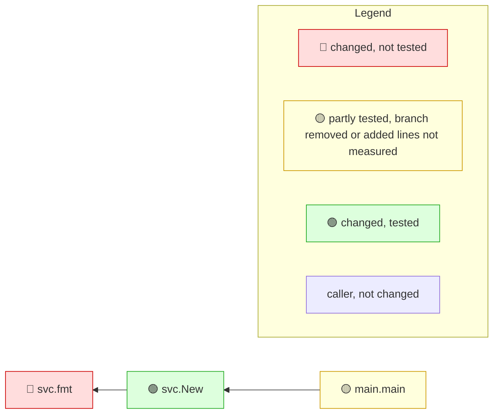

<!-- mrimpact:v1 -->
### 🔍 MR impact — 6 functions changed
**🔴 1 · 🟡 1 · 🟢 1** · coverage: `coverprofile` · base `0000000`\
+3 new functions folded into 1 group

👉 **Look at first:** `svc.fmt` (untested, 2 callers) · `main.main` (untested, no callers)

All changes shown are reached from: main

| Risk | Function | Change | Callers | Entry points | Added-line coverage |
|---|---|---|---|---|---|
| 🔴 | `svc.fmt` | new | 2 (2 pkgs) | api `svc.New` | 0 % (0/5) |
| 🟡 | `main.main` | body · wiring | 0 | — | no added lines · not reached |
| 🟢 | `svc.New` | new · +3 | 1 | api `svc.New` | 100 % (19/19) |

svc.New +3 new

- 🟢 `svc.(*S).apply` · new · 100 % (4/4) — `svc/svc.go`
- 🟢 `svc.load` · new · 100 % (5/5) — `svc/svc.go`
- 🟢 `svc.price` · new · 100 % (5/5) — `svc/svc.go`

Uncovered added lines (1 functions)

- `svc.fmt` — `svc/svc.go:31-35`

📝 Declarations changed: `type S in svc/svc.go`

**How to read the diagram:** coloured boxes are functions this MR changed (🔴 not tested · 🟡 partly tested, branch removed or added lines not measured · 🟢 tested); plain boxes are callers the MR did not change; an arrow points from a caller to the function it calls; a dashed arrow means the function is passed as a callback (registered) and called through it. Every caller is listed under *All callers*.

All callers (3)

**`svc.fmt`** (2)

- depth 1: `svc.New`
- depth 2: `main.main`

**`svc.New`** (1)

- depth 1: `main.main`

⚠️ Limits of this analysis

- Calls via `reflect` or dynamic registration (e.g. handlers by name) are not detected.
- This repo only: callers in other services (HTTP/gRPC) are not visible.
- Functions called only from dependencies (e.g. HTTP handlers registered with net/http) or from package-level initializers show no callers (methods the standard library calls on interface values, such as `Error`, `Unwrap` or `ServeHTTP`, count as reached from the code that converts their type to an interface; see the list in the reference); where such a function is registered is listed under Registered.
- Now unused: uses through `reflect`, `//go:linkname` or other repositories are not seen; exported methods, and exported functions of packages other modules can import, are never listed.

Rules: 🔴 untested with callers, or exported signature changed in an importable package · 🟡 partial, untested with no callers, a branch removed, or added lines not measured · 🟢 covered, or no added lines and reached by a test · wiring (straight-line setup) at most 🟡 · sensitive and untested 🔴 · mrimpact test · 0.0 s
