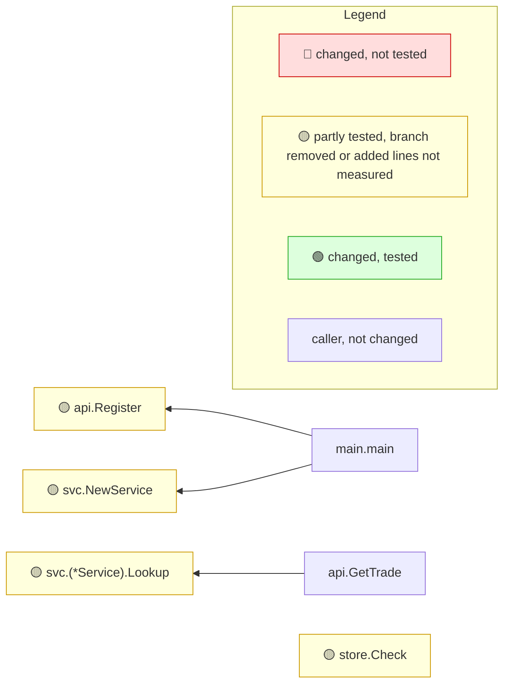

<!-- mrimpact:v1 -->
### 🔍 MR impact — 4 functions changed
**🔴 0 · 🟡 4 · 🟢 0** · coverage: `coverprofile` · base `0000000`

👉 **Look at first:** `api.Register` (wiring, untested) · `svc.(*Service).Lookup` (partly tested, 40 %) · `svc.NewService` (wiring, untested) +1

🔌 **Registrations changed** (1, positions in head):

- `GET …/trade/:id` → `api.GetTrade`: + `mw` — `api/api.go:21`

| Risk | Function | Change | Callers | Entry points | Added-line coverage |
|---|---|---|---|---|---|
| 🟡 | `api.Register` | body · wiring | 1 | api `api.Register`, main | 0 % (0/1) |
| 🟡 | `svc.(*Service).Lookup` | body | 1 | `GET …/trade/:id`, api `api.GetTrade` +1 | 40 % (2/5) |
| 🟡 | `svc.NewService` | body · wiring | 1 | api `svc.NewService`, main | 0 % (0/1) |
| 🟡 | `store.Check` | body · wiring | 0 | api `store.Check` | 0 % (0/1) |

Uncovered added lines (4 functions)

- `api.Register` — `api/api.go:21`
- `svc.(*Service).Lookup` — `svc/svc.go:14-16`
- `svc.NewService` — `svc/svc.go:9`
- `store.Check` — `store/store.go:12`

📝 Declarations changed: `type Service in svc/svc.go`

🧪 Tests touched in this MR: `svc/svc_test.go`

**How to read the diagram:** coloured boxes are functions this MR changed (🔴 not tested · 🟡 partly tested, branch removed or added lines not measured · 🟢 tested); plain boxes are callers the MR did not change; an arrow points from a caller to the function it calls; a dashed arrow means the function is passed as a callback (registered) and called through it. Every caller is listed under *All callers*.

All callers (3)

**`api.Register`** (1)

- depth 1: `main.main`

**`svc.(*Service).Lookup`** (1)

- depth 1: `api.GetTrade`

**`svc.NewService`** (1)

- depth 1: `main.main`

⚠️ Limits of this analysis

- Calls via `reflect` or dynamic registration (e.g. handlers by name) are not detected.
- This repo only: callers in other services (HTTP/gRPC) are not visible.
- Functions called only from dependencies (e.g. HTTP handlers registered with net/http) or from package-level initializers show no callers (methods the standard library calls on interface values, such as `Error`, `Unwrap` or `ServeHTTP`, count as reached from the code that converts their type to an interface; see the list in the reference); where such a function is registered is listed under Registered.
- Now unused: uses through `reflect`, `//go:linkname` or other repositories are not seen; exported methods, and exported functions of packages other modules can import, are never listed.

Rules: 🔴 untested with callers, or exported signature changed in an importable package · 🟡 partial, untested with no callers, a branch removed, or added lines not measured · 🟢 covered, or no added lines and reached by a test · wiring (straight-line setup) at most 🟡 · sensitive and untested 🔴 · mrimpact test · 0.0 s
