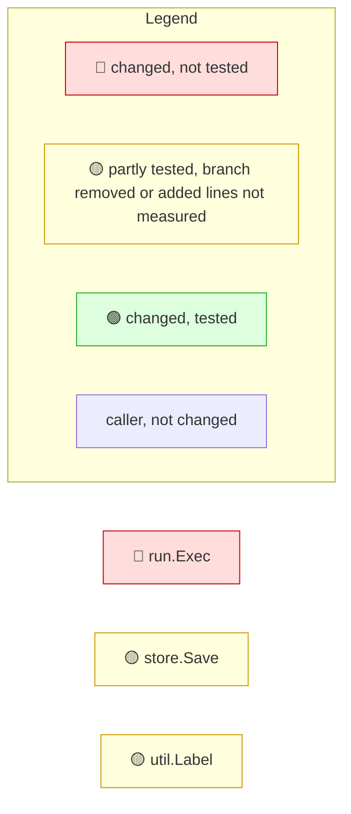

<!-- mrimpact:v1 -->
### 🔍 MR impact — 3 functions changed
**🔴 1 · 🟡 2 · 🟢 0** · coverage: `static` · base `0000000`

👉 **Look at first:** `run.Exec` (sensitive, untested) · `util.Label` (untested, no callers) · `store.Save` (added lines not measured)

🔐 **Sensitive code changed** (2):

- 🔴 `run.Exec` — os/exec.Command, os/exec.(*Cmd).Run · not reached
- 🟡 `store.Save` — database/sql.(*DB).ExecContext · reached by test · added lines not measured

| Risk | Function | Change | Callers | Entry points | Added-line coverage |
|---|---|---|---|---|---|
| 🔴 | `run.Exec` | new · sensitive | 0 | api `run.Exec` | not reached |
| 🟡 | `store.Save` | body · sensitive | 0 | api `store.Save` | reached by test · added lines not measured |
| 🟡 | `util.Label` | body | 0 | api `util.Label` | not reached |

**How to read the diagram:** coloured boxes are functions this MR changed (🔴 not tested · 🟡 partly tested, branch removed or added lines not measured · 🟢 tested); plain boxes are callers the MR did not change; an arrow points from a caller to the function it calls; a dashed arrow means the function is passed as a callback (registered) and called through it. Every caller is listed under *All callers*.

All callers (0)

⚠️ Limits of this analysis

- Calls via `reflect` or dynamic registration (e.g. handlers by name) are not detected.
- This repo only: callers in other services (HTTP/gRPC) are not visible.
- Functions called only from dependencies (e.g. HTTP handlers registered with net/http) or from package-level initializers show no callers (methods the standard library calls on interface values, such as `Error`, `Unwrap` or `ServeHTTP`, count as reached from the code that converts their type to an interface; see the list in the reference); where such a function is registered is listed under Registered.
- Now unused: uses through `reflect`, `//go:linkname` or other repositories are not seen; exported methods, and exported functions of packages other modules can import, are never listed.

Rules: 🔴 untested with callers, or exported signature changed in an importable package · 🟡 partial, untested with no callers, a branch removed, or added lines not measured · 🟢 covered, or no added lines and reached by a test · wiring (straight-line setup) at most 🟡 · sensitive and untested 🔴 · mrimpact test · 0.0 s
